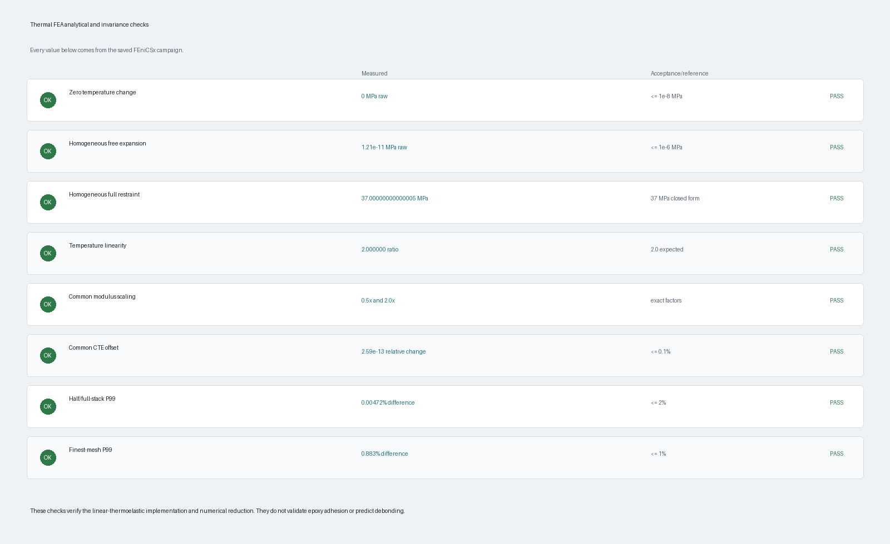
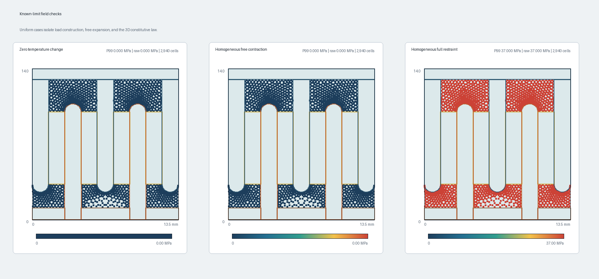
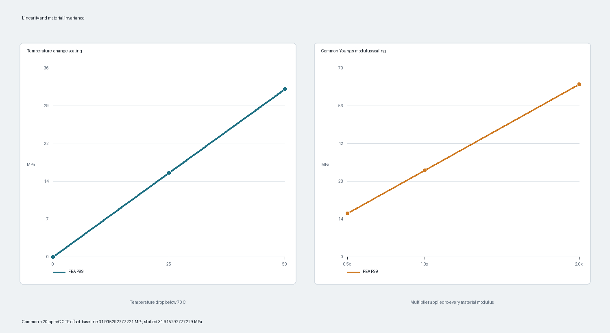
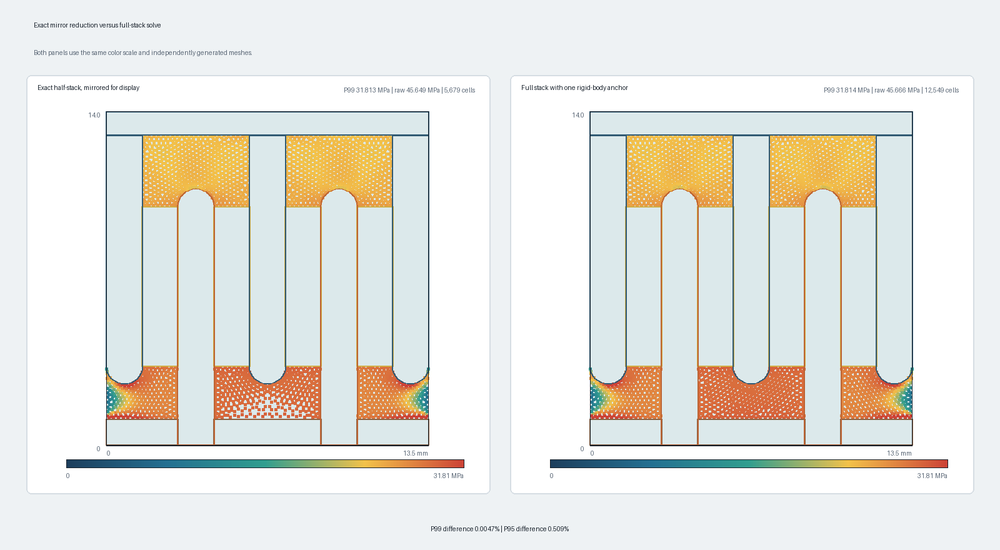
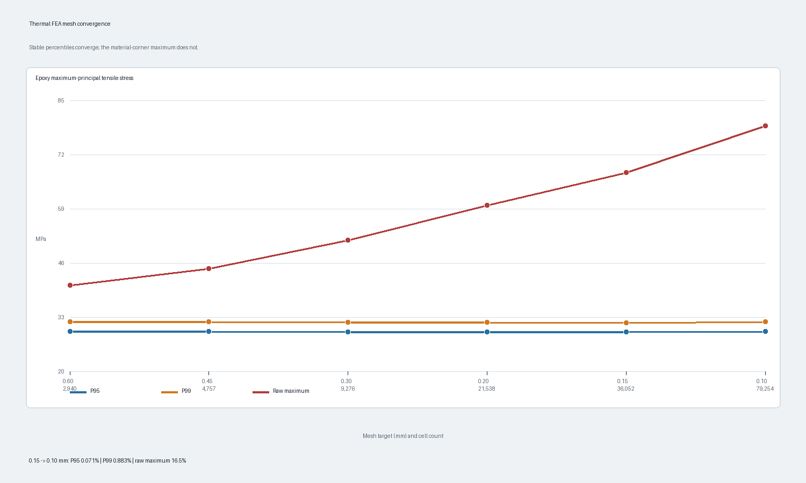
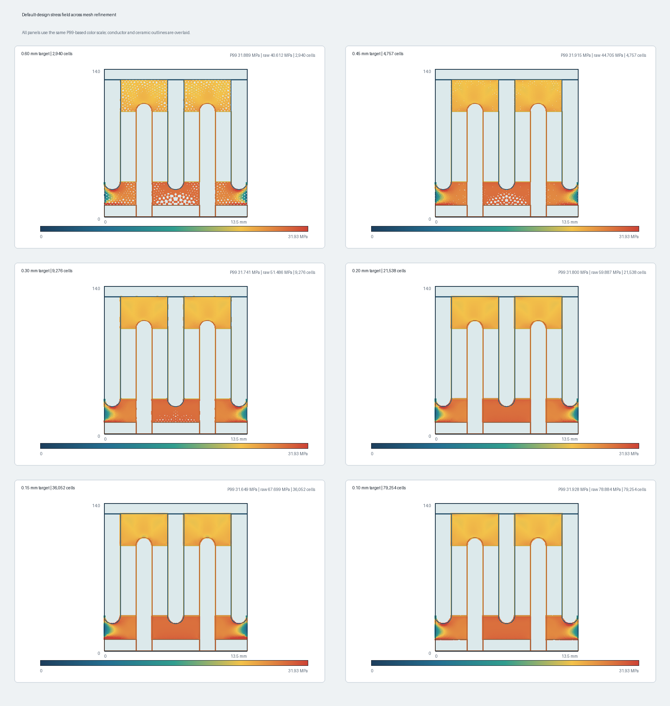

# Thermal FEA verification

For the complete project-level order of operations—including software
regressions, deployed smoke tests, electrostatic checks, resource rules, and
manual browser review—start with the
[verification and validation runbook](validation-runbook.md).

## Status

The axisymmetric linear-thermoelastic FEniCSx implementation passed a
reproducible verification campaign on 2026-07-30. The campaign checks
zero-load behavior, free thermal expansion, a closed-form fully restrained
limit, linear scaling, CTE invariance, exact axial symmetry, and mesh
convergence.

This verifies the equations, boundary-condition implementation, symmetry
reduction, and numerical trends of the current elastic model. It does **not**
validate MG Chemicals 9510 material assumptions, epoxy adhesion, cure
shrinkage, viscoelastic relaxation, cohesive failure, or a separation
temperature.



All source inputs and full cell-center fields are retained under
`simulations/thermal/validation/`. The executable campaign is
`software/bias_filter/thermal_validation.py`; the image generator is
`software/bias_filter/plot_thermal_validation.py`.

## Model under test

The production thermal solver uses:

- Small-strain, isotropic, axisymmetric linear thermoelasticity.
- Radial, circumferential, axial, and r-z shear strain components.
- A `2 pi r` integration weight for the cylindrical volume represented by the
  r-z mesh.
- Perfect displacement continuity across copper, alumina, epoxy, and core
  regions.
- Traction-free exposed surfaces.
- `u_r = 0` on the cylindrical axis.
- By default, `u_z = 0` on the exact axial mirror plane and only one physical
  half-stack is meshed.
- A uniform temperature change from the assumed 70 C stress-free reference.

The constitutive law is

```text
epsilon_mech = epsilon(u) - alpha delta_T I
sigma = 2 mu epsilon_mech + lambda tr(epsilon_mech) I
```

with

```text
mu = E / [2 (1 + nu)]
lambda = E nu / [(1 + nu) (1 - 2 nu)]
```

The reported epoxy maximum-principal tensile stress is obtained by forming
the full axisymmetric 3D stress tensor at every epoxy cell center:

```text
[ sigma_rr   0          sigma_rz ]
[ 0          sigma_tt   0        ]
[ sigma_rz   0          sigma_zz ]
```

The largest eigenvalue is clipped at zero so a wholly compressive cell does
not report tensile stress. P95 and P99 are percentiles of the epoxy
cell-center samples. The mesh is close to uniform, and convergence is checked
explicitly, but these are cell-count percentiles rather than
axisymmetric-volume-weighted percentiles.

## Acceptance criteria and results

| Check | Acceptance criterion | Result |
| --- | --- | --- |
| Zero temperature change | Raw tensile maximum `<= 1e-8 MPa` | `0 MPa`; pass |
| Homogeneous free contraction | Raw tensile maximum `<= 1e-6 MPa` | `1.21e-11 MPa`; pass |
| Homogeneous full restraint | P99 within `0.1%` of closed form | `37.00000000000005 MPa` versus `37 MPa`; pass |
| Temperature scaling | 50 C-drop P99 / 25 C-drop P99 within `0.1%` of 2 | `2.000000`; pass |
| Common modulus scaling | Common 0.5x and 2x modulus changes P99 by those factors within `0.1%` | `0.500000x`, `2.000000x`; pass |
| Common CTE offset | Adding 20 ppm/C to every material changes P99 by `<= 0.1%` | `2.59e-13` relative; pass |
| Exact mirror reduction | Half/full P95 and P99 differ by `<= 2%` | P95 `0.509%`, P99 `0.00472%`; pass |
| Mesh convergence | Two finest meshes differ by `<= 1%` for P95 and P99 | P95 `0.071%`, P99 `0.883%`; pass |

The criteria are code-verification tolerances. They are not mechanical design
allowables.

## Known-limit checks



### Zero temperature change

At the 70 C reference temperature, the thermal strain and load must be exactly
zero for the normal production geometry. The first campaign run exposed a real
edge-case bug here: multiplying the weak-form load by the Python scalar
`0.0` caused UFL to lose the integration domain and reject the form.

The solver now represents temperature change as a domain-associated FEniCS
constant. The corrected case solves normally and returns exactly `0 MPa`.
Nonzero-temperature results were not numerically affected by this defect.

### Homogeneous free contraction

All four material regions are assigned identical properties:

```text
E = 3000 MPa
nu = 0.35
alpha = 74e-6 /C
delta_T = -50 C
```

The geometric partitions and internal interfaces remain in the mesh, but they
are mechanically invisible. With traction-free external surfaces, the exact
solution is free contraction and zero stress. The raw epoxy tensile maximum is
`1.2137e-11 MPa`, which is numerical roundoff relative to the approximately
30 MPa design-scale result.

This check exercises the thermal load, cylindrical hoop strain, internal
material partitioning, axis boundary, and mirror-plane boundary together.

### Homogeneous full restraint

The same homogeneous body is constrained radially at its outer surface and
axially at both ends. Together with the cylindrical-axis condition, the exact
displacement is zero. Uniform cooling therefore creates equal tensile stress
in all three normal directions:

```text
sigma = E alpha |delta_T| / (1 - 2 nu)
      = 3000 MPa * 74e-6 /C * 50 C / (1 - 2 * 0.35)
      = 37 MPa
```

FEniCSx returns `37.00000000000005 MPa`, a relative error of
`1.73e-15`. This directly checks the Lamé-parameter conversion, subtraction of
thermal strain, hoop term, and principal-stress recovery.

## Scaling and invariance



### Temperature

Linear thermoelastic stress must be proportional to temperature change while
properties and boundary conditions remain fixed. The default geometry was
solved at 45 C and 20 C, corresponding to drops of 25 C and 50 C below the
70 C reference. The P99 ratio is exactly `2.0`.

This confirms the browser's use of linear temperature scaling is consistent
with the solved model, provided material properties remain temperature
independent. Real epoxy properties and relaxation are temperature dependent,
so this mathematical result does not establish physical linearity over an
arbitrary operating range.

### Common modulus multiplier

Every material modulus was multiplied by `0.5` and then by `2.0`, with CTE and
Poisson ratio unchanged. If all stiffnesses share one multiplier, equilibrium
displacements remain unchanged and every stress must scale by that multiplier.
The P99 ratios are exactly `0.5` and `2.0`.

This is not the same as changing only the epoxy modulus. Changing one
material's modulus changes the stiffness ratios and therefore changes both
displacement and stress distribution.

### Common CTE offset

The same `+20 ppm/C` offset was added to every material CTE. A common thermal
strain changes free assembly displacement but cannot change mismatch stress in
a traction-free bonded assembly. P99 changed from
`31.915292777221 MPa` to `31.915292777229 MPa`, a relative difference of
`2.59e-13`.

This is a strong check that the solver responds to CTE differences rather than
to an unintended absolute-CTE restraint.

## Exact axial symmetry



The production model meshes one physical end through the exact center plane
and applies `u_z = 0` at that plane. The reference model meshes the full stack,
removes the center-plane boundary condition, and uses only one axial
rigid-body anchor at `r = 0`, `z = L/2`.

At a 0.40 mm target size:

| Quantity | Mirror half | Full stack | Relative difference |
| --- | ---: | ---: | ---: |
| Cells | 5,679 | 12,549 | n/a |
| P95 tensile stress | 29.5040 MPa | 29.6550 MPa | 0.509% |
| P99 tensile stress | 31.8126 MPa | 31.8141 MPa | 0.00472% |
| Raw maximum | 45.6486 MPa | 45.6656 MPa | 0.0373% |

The small P95 difference is consistent with independently generated
unstructured meshes and a percentile evaluated from cell samples. The P99 and
raw maxima agree much more closely. The field maps also recover the expected
mirror symmetry without imposing it in the full-stack reference.

## Mesh convergence





| Target size | Cells | P95 | P99 | Raw maximum |
| ---: | ---: | ---: | ---: | ---: |
| 0.60 mm | 2,940 | 29.6356 MPa | 31.8891 MPa | 40.6121 MPa |
| 0.45 mm | 4,757 | 29.5356 MPa | 31.9153 MPa | 44.7048 MPa |
| 0.30 mm | 9,276 | 29.5210 MPa | 31.7410 MPa | 51.4860 MPa |
| 0.20 mm | 21,538 | 29.5029 MPa | 31.8004 MPa | 59.8865 MPa |
| 0.15 mm | 36,052 | 29.5081 MPa | 31.6487 MPa | 67.6988 MPa |
| 0.10 mm | 79,254 | 29.5291 MPa | 31.9281 MPa | 78.8840 MPa |

P95 is stable over the entire sweep. P99 remains near 31.8 MPa and the two
finest cases differ by 0.883%, just within the stated 1% criterion. Its small
non-monotonic movement is expected for an unweighted percentile of cell
samples on independently generated meshes.

The raw maximum increases monotonically as the mesh resolves the
copper/alumina/epoxy material corner. It changes by 16.5% between the two
finest meshes and has not converged. This is characteristic of a
perfectly-bonded sharp material junction in linear elasticity. The raw maximum
must remain a diagnostic, not a predicted bond-failure stress.

The 0.30 mm GUI default gives P99 `31.741 MPa`, within 0.59% of the 0.10 mm
reference. It remains suitable for interactive trend work. A design result
used in a report should be repeated at 0.20 mm or finer and accompanied by its
mesh record.

## What has and has not been verified

The campaign supports these conclusions:

- The thermal weak form has the correct zero-load limit.
- A uniform body can contract freely without spurious interface stress.
- Full restraint reproduces the three-direction closed form.
- Temperature and common stiffness scaling behave exactly as linear theory
  requires.
- Only relative CTE creates mismatch stress.
- The exact center-plane reduction reproduces the full-stack solution.
- P95 and P99 are stable enough for comparative design work at the tested
  meshes.
- The sharp-junction raw maximum is not a converged quantity.

The campaign does not support these conclusions:

- That 31 to 32 MPa is the actual stress in cured MG 9510.
- That the datasheet's bulk tensile strength can be used as an interface
  separation criterion.
- That the bond opens at any specific temperature.
- That a perfect bond, linear elasticity, or the 70 C stress-free reference is
  physically exact.
- That cure shrinkage, thermal cycling, creep, or damage can be neglected.

## Reproduction

On a Pi with the project FEniCSx dependencies installed:

```bash
cd /path/to/DiscoidalCapacitorBiasFilter
/usr/bin/python3 software/bias_filter/thermal_validation.py
```

Generate the PNGs in an environment with Pillow:

```bash
python software/bias_filter/plot_thermal_validation.py
```

The exact file inventory and every per-mesh image are documented in
`simulations/thermal/validation/README.md`.
