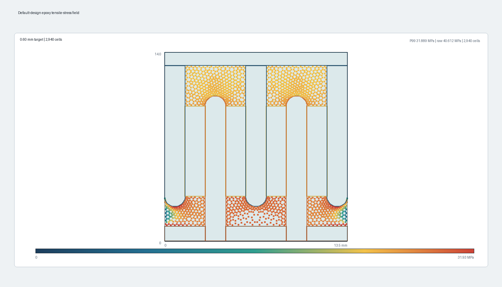
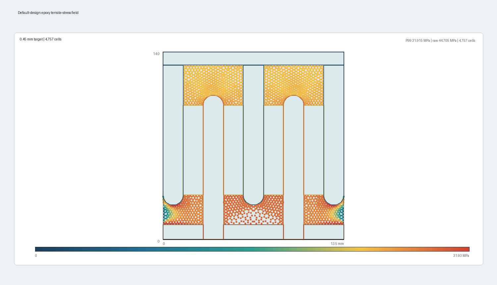
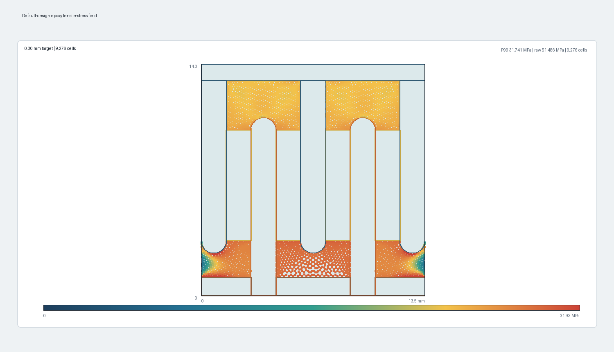
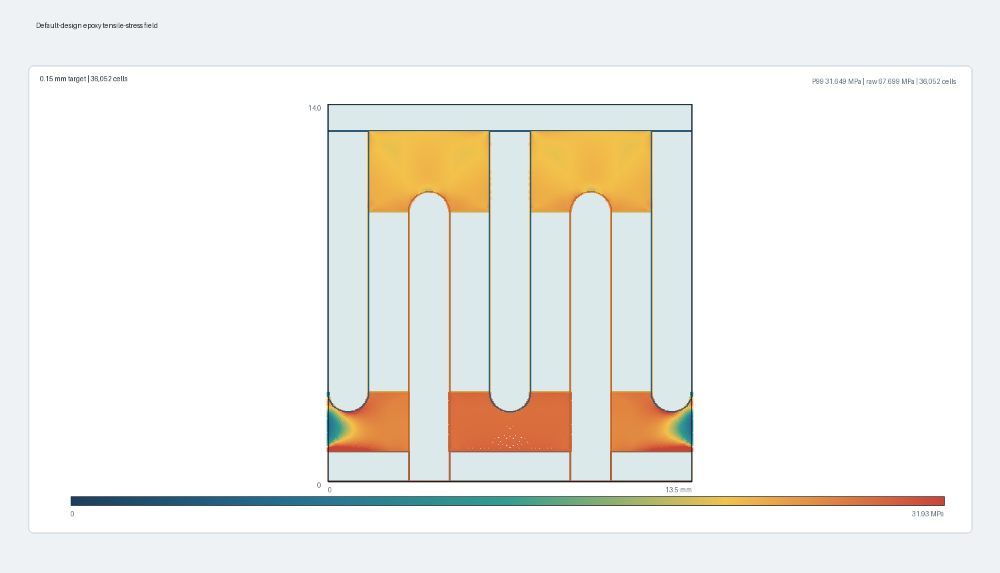
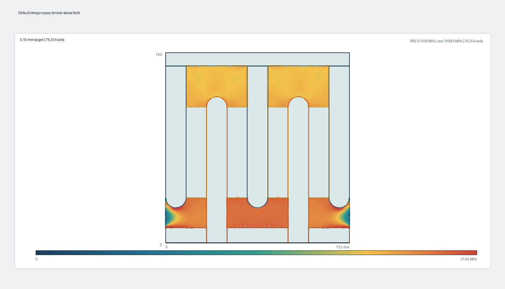

# Thermal FEA validation artifacts

## Purpose

This directory contains the complete 2026-07-30 verification campaign for the
axisymmetric FEniCSx thermal-stress solver. It is an executable code and
numerical verification record, not an epoxy adhesion qualification.

The interpretation and equations are documented in
`docs/knowledge/thermal-fea-verification.md`.

## Reproduce the solves

Run on a host with the project's FEniCSx, Gmsh, PETSc, MPI, and NumPy
dependencies:

```bash
cd /path/to/DiscoidalCapacitorBiasFilter
/usr/bin/python3 software/bias_filter/thermal_validation.py
```

The command rewrites:

- `thermal-validation-results.json`: compact campaign summary, acceptance
  checks, mesh table, and links to every case.
- `cases/*.json`: complete normalized inputs, mesh metadata, assumptions,
  stress statistics, and sampled epoxy stress field for one solve.

Generate the images with Pillow installed:

```bash
python software/bias_filter/plot_thermal_validation.py
```

The plotting command reads only the checked-in JSON files. It does not rerun
or alter the FEA.

## Case inventory

| Case file | Purpose |
| --- | --- |
| `zero_temperature_change.json` | Exact no-load limit at the 70 C reference |
| `homogeneous_free_expansion.json` | Zero-stress free contraction with all properties equal |
| `homogeneous_fully_restrained.json` | Closed-form triaxial stress benchmark |
| `temperature_45c.json` | 25 C temperature-drop linearity point |
| `temperature_20c.json` | 50 C temperature-drop linearity point |
| `all_moduli_half.json` | Common 0.5x modulus multiplier |
| `all_moduli_double.json` | Common 2x modulus multiplier |
| `common_cte_offset.json` | Common +20 ppm/C CTE shift |
| `symmetry_mirror_half.json` | Production exact-half strategy |
| `symmetry_full_stack.json` | Full-stack symmetry reference |
| `mesh_0p6_mm.json` | 0.60 mm mesh-convergence field |
| `mesh_0p45_mm.json` | 0.45 mm mesh-convergence field |
| `mesh_0p3_mm.json` | 0.30 mm mesh-convergence field |
| `mesh_0p2_mm.json` | 0.20 mm mesh-convergence field |
| `mesh_0p15_mm.json` | 0.15 mm mesh-convergence field |
| `mesh_0p1_mm.json` | 0.10 mm mesh-convergence field |

## Summary images


## Individual mesh fields

### 0.60 mm



### 0.45 mm



### 0.30 mm



### 0.20 mm


### 0.15 mm



### 0.10 mm



## Data interpretation

The field PNGs show epoxy cell-center maximum-principal tensile stress. The
axisymmetric half-stack result is mirrored only for display. Copper, alumina,
and core outlines come from the normalized geometry stored in each result.

Each field color scale is capped at the largest P99 in the mesh sweep so the
bulk pattern remains comparable. Values above that limit saturate red. The raw
maximum remains available in the panel text and JSON.

Do not infer a separation location directly from a saturated corner pixel.
The current model makes every interface perfectly bonded, so opening and
sliding are impossible by construction.
